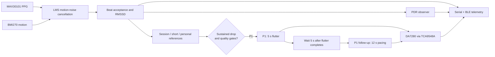
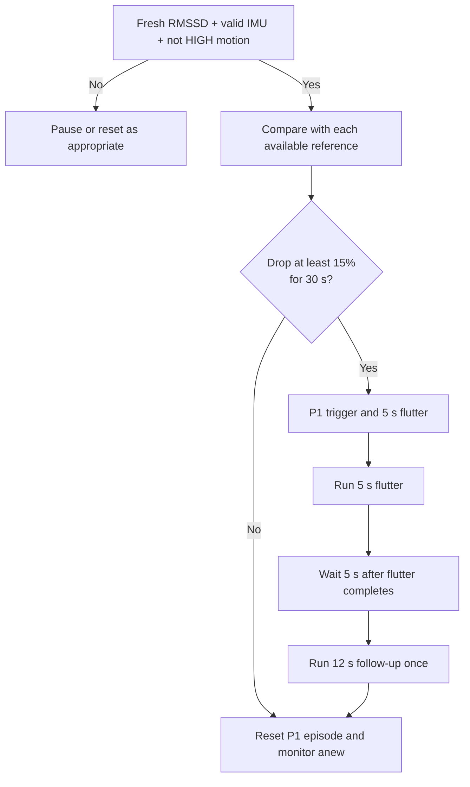

# SUTRA firmware guide

SUTRA is an ESP32-S3 wearable prototype that derives heart-rate variability
(RMSSD) from MAX30101 PPG data, uses BMI270 motion data to qualify that signal,
and can present local haptic interventions. BLE exposes the same labelled status
groups as the serial monitor. The firmware is a prototype: it does not diagnose
stress, and PDR is context rather than a trigger.

## Main features

| Feature | What it does | Important boundary |
|---|---|---|
| PPG and LMS beat processing | Cleans PPG with a motion-informed LMS path, detects usable beats, and calculates RMSSD. | Rejected, stale, or no-contact data cannot qualify a trigger. |
| Three RMSSD references | Uses a startup session median, an adapting five-minute short reference, and a persisted seven-session median. | Seven startup sessions are a prototype stand-in for daily measurements. |
| P1 episode logic | Triggers at a 15% RMSSD drop held for 30 s. | One trigger with a two-stage intervention; not a clinical conclusion. |
| Haptic patterns | Generates a 5 s random three-motor flutter, then a 12 s follow-up after a 5 s post-flutter delay. | M1/M2/M3 are DA7280 drivers on TCA9548A channels 0/1/2. |
| PDR observer | Estimates display-only respiratory-rate context from RIFV; RIAV remains diagnostic. | It never gates, changes, or triggers either P1 stage. |
| BLE telemetry | Provides grouped UTF-8 read fields plus a notification stream that mirrors serial output. | Notifications are best effort, not a beat-by-beat recording. |

## System flow

[Overall Project Flowchart (PDF)](pdfs/Sutra_Overall_Project_Flowchart_1.pdf)



## RMSSD intervention decision flow



Follow-up is issued once per P1 trigger. The delay begins only after the initial
flutter stops successfully. Once armed, later RMSSD, reference, signal, or motion
changes do not cancel or restart it; a haptic execution failure can cancel it.

## P1 follow-up pacing chart

The runtime and startup test both use all three motors.

```mermaid
gantt
    title One 12-second P1 follow-up breathing cycle
    dateFormat  X
    axisFormat %Ls
    section Left / Motor 1
    Inhale ramp 5 to 45 : 0, 3000
    Exhale ramp 25 to 0 : 7000, 5000
    section Centre / Motor 2
    Hold 50 : 3000, 1000
    Ease 50 to 25 : 5000, 2000
    section Right / Motor 3
    Inhale ramp 5 to 45 : 0, 3000
    Exhale ramp 25 to 0 : 7000, 5000
```



## Detailed documents

[Hardware Schematic (PDF)](pdfs/Sutra_Hardware_Schematic.pdf)

- [Haptic protocols](haptic-protocols.md) — wiring scope, patterns, output scaling, and faults.
- [LMS and Elgendi pipeline](lms-elgendi.md) — PPG cleaning, beat acceptance, variables, and signal-quality gates.
- [RMSSD references](rmssd-references.md) — baselines, trigger holds, recovery, and persistence.
- [PDR observer](pdr-observer.md) — respiration estimation and its non-gating role.
- [BLE telemetry](ble-telemetry.md) — service UUIDs, grouped fields, and notification behaviour.

## Build and test

```text
pio run -e seeed_xiao_esp32s3
pio test -c platformio-test.ini -e native
```

The host tests verify deterministic algorithms and simulated I2C behavior.
Hardware testing is still required for sensor accuracy, vibration strength,
timing under load, BLE performance, and safe power behavior.

BLE is enabled by default. Set `SUTRA_BLE_ENABLED` to `0` near the top of
`src/main.cpp` to build a Serial-only firmware.

## Project Resources

- [Bill of Materials (BOM)](https://docs.google.com/spreadsheets/d/16jnI_RCqciEDVtymS20RvoI0vGWJDaZCuYVPvfLnU6E/edit?usp=sharing)
- [Logs and Results](https://drive.google.com/drive/folders/1aVeMRzjL6tW-ZZqQDzd-o6AU2fAeIhfH)
- [Sutra Code Overview (PDF)](pdfs/Sutra_Code_Overview.pdf)
