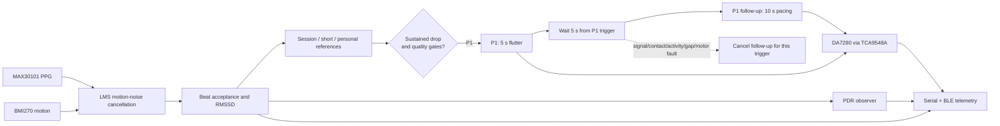
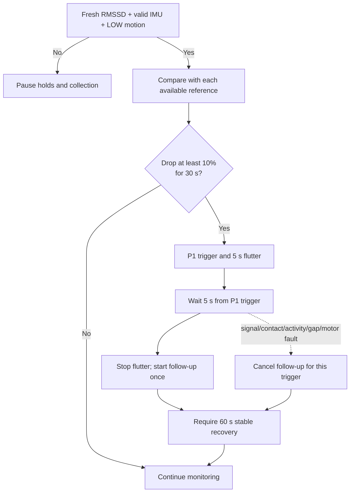

# SUTRA firmware guide

SUTRA is an ESP32-S3 wearable prototype that derives heart-rate variability
(RMSSD) from MAX30101 PPG data, uses BMI270 motion data to qualify that signal,
and can present local haptic interventions. BLE exposes the same labelled status
groups as the serial monitor. The firmware is a prototype: it does not diagnose
stress, and PDR is context rather than a trigger.

## Main features

| Feature | What it does | Important boundary |
|---|---|---|
| PPG and LMS beat processing | Cleans PPG with a motion-informed LMS path, detects usable beats, and calculates RMSSD. | Rejected, stale, or no-contact data cannot qualify a trigger. |
| Three RMSSD references | Uses a startup session median, an adapting five-minute short reference, and a persisted seven-session median. | Seven startup sessions are a prototype stand-in for daily measurements. |
| P1 episode logic | Triggers at a 10% RMSSD drop held for 30 s, then requires stable recovery before rearming. | One trigger with a conditionally scheduled follow-up; not a clinical conclusion. |
| Haptic patterns | Generates a 5 s P1 flutter and automatically starts a 10 s follow-up sweep five seconds after the P1 trigger at the unchanged 20% output scale. | Firmware currently drives one DA7280/LRA on mux channel 0; the library is three-motor capable. |
| PDR observer | Estimates respiratory-rate context from RIAV/RIFV for display. | It never gates, changes, or triggers either P1 stage. |
| BLE telemetry | Provides grouped UTF-8 read fields plus a notification stream that mirrors serial output. | Notifications are best effort, not a beat-by-beat recording. |

## System flow



## RMSSD intervention decision flow



Follow-up is issued once per P1 trigger. A recovered RMSSD deviation or changed
reference does not cancel or restart the delay; signal/contact/activity, timing,
or motor failures do.
The initial flutter is stopped cleanly before the follow-up starts.

## P1 follow-up pacing chart

The following timeline is the three-logical-motor pattern. In the current
single-motor hardware configuration, only the left/Motor 1 spans are actuated.

```mermaid
gantt
    title One 10-second P1 follow-up breathing cycle
    dateFormat  X
    axisFormat %Ls
    section Left / Motor 1
    Inhale ramp 10–50% : 0, 1300
    Exhale ramp 30–0% : 6000, 4000
    section Centre / Motor 2
    Hold then ease 60–30% : 2600, 3400
    section Right / Motor 3
    Inhale ramp 10–50% : 1300, 1300
```



## Detailed documents

- [Haptic protocols](haptic-protocols.md) — wiring scope, patterns, output scaling, and faults.
- [LMS and Elgendi pipeline](lms-elgendi.md) — PPG cleaning, beat acceptance, variables, and signal-quality gates.
- [RMSSD references](rmssd-references.md) — baselines, trigger holds, recovery, and persistence.
- [PDR observer](pdr-observer.md) — respiration estimation and its non-gating role.
- [BLE telemetry](ble-telemetry.md) — service UUIDs, grouped fields, and notification behaviour.

## Build and test

```text
pio run -e seeed_xiao_esp32s3
pio test -c platformio-test.ini -e native
```

The host tests verify deterministic algorithms and simulated I2C behavior.
Hardware testing is still required for sensor accuracy, vibration strength,
timing under load, BLE performance, and safe power behavior.
