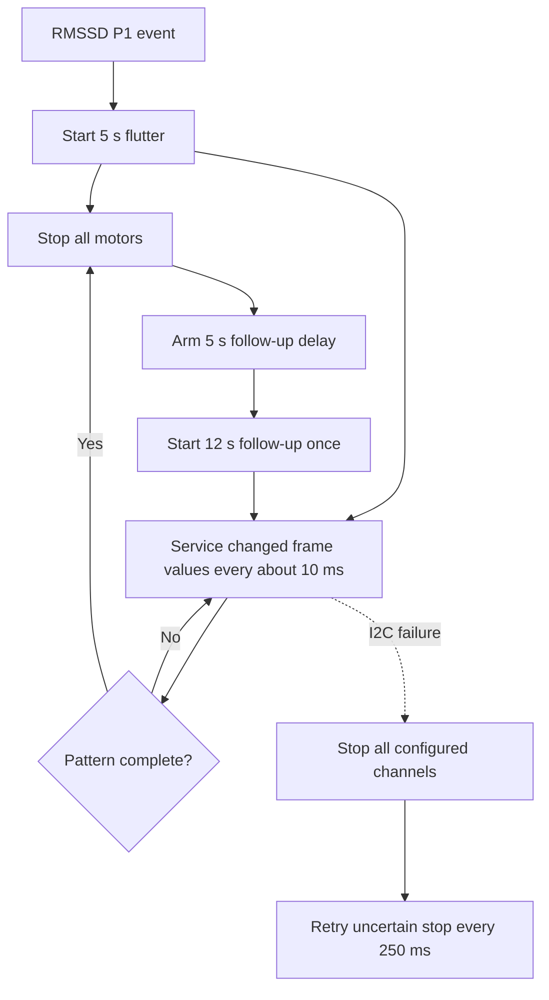

# Haptic actuation

The PoC uses one RMSSD P1 trigger with two haptic stages. The initial flutter
lasts five seconds. Once it has completed and all motors are stopped, a
nonblocking five-second delay is armed. The P1 follow-up then runs once for
twelve seconds. It is not an independent P2 trigger.

## Current hardware scope

The runtime configuration enables three SmartElex DA7280 modules. Motor 1,
Motor 2, and Motor 3 use TCA9548A channels 0, 1, and 2 respectively. There is
no output scaling: `outputScalePercent = 100`, so the direct DA7280 values in
the supplied reference patterns are preserved.

The P1 RMSSD drop threshold is 15%, with a 30-second trigger hold. There is no
independent second trigger or threshold. Both P1 stages update all three motor
frames when their levels change.

## Hardware mapping

The existing XIAO ESP32S3 I2C bus uses GPIO 5 for SDA and GPIO 6 for SCL at 400 kHz.
The MAX30101 and BMI270 remain on that root bus. The TCA9548A address is `0x70`.

| Logical motor | Position | Mux channel | DA7280 address | Enabled now |
|---|---|---|---|---|
| Motor 1 | Left | 0 | `0x4A` | Yes |
| Motor 2 | Center / P6 | 1 | `0x4A` | Yes |
| Motor 3 | Right | 2 | `0x4A` | Yes |

The driver selects one mux channel per DA7280 transfer and deselects all channels
before returning to sensor traffic. A configured DA7280 retains its output after
the mux changes channel, allowing M1 and M3 to run together. The mux does not
provide motor power or directly drive an LRA.

Haptic transactions run at 100 kHz; the adapter restores the 400 kHz sensor bus
speed after each transaction. Each driver uses the register equivalent of the
reference sketch's `defaultMotor()`, `enableFreqTrack(false)`, `DRO_MODE`, and
`setVibrate(0)` setup. Frequency tracking is disabled and frame values are
converted to DA7280's 0-127 DRO code range without an additional scale factor.

## P1: randomized flutter

- Duration: 5 seconds.
- One motor is active at direct DRO value 60 for each 200 ms slot.
- Each group of three slots contains M1, M2, and M3 exactly once in a new random
  order.
- There is no intentional gap between slots.
- All motors stop at completion.

## P1 follow-up: resonant pacing sweep

| Time within each cycle | Motor 1 | Motor 2 | Motor 3 |
|---|---|---|---|
| 0-3 s | ramp 5 -> 45 | Off | ramp 5 -> 45 |
| 3-4 s | Off | 50 | Off |
| 4-5 s | Off | Off | Off |
| 5-7 s | Off | ramp 50 -> 25 | Off |
| 7-12 s | ramp 25 -> 0 | Off | ramp 25 -> 0 |

Ramps are linear in direct DRO command values. Cycle timing is derived from
elapsed time, so late loop calls do not accumulate drift. The firmware services
envelopes about every 10 ms. I2C transfers and loop scheduling introduce timing
quantization; this is not a hardware-timed waveform generator.

## Runtime status and faults

The transport uses TCA9548A channel selection to address one identical-address
DA7280 at a time. A previously addressed driver keeps its amplitude after mux
disconnect, so multi-motor envelopes can overlap when configured.

Before sensor initialization, startup runs `BOOT_TEST`: the complete 12-second
follow-up waveform is played through all three motors. Confirm each motor and
ramp by touch. The test uses a separate three-motor array. If a test branch is
missing or faults, the failure is logged and sensor initialization continues.

While a protocol is playing, changed frames are serviced about every 10 ms.
At normal completion the firmware sends a stop command and logs P1 initial or
follow-up completion. I2C failures stop the sequence; shutdown is retried every
250 ms if its acknowledgement is uncertain. `Array::pollFaults()` remains
available for diagnostics and host tests but is not run as a pre-start or
periodic runtime sweep.
`FAULT_STOP_PENDING` means the firmware cannot yet confirm a stop.
Haptic state is reported as `OFF`, `P1_FLUTTER`, `P1_FOLLOW_UP`, `FAULT`, or
`FAULT_STOP_PENDING`.

The follow-up begins only after a successful stop of the flutter. New initial
requests cannot interrupt an active pattern. Serial reports P1 trigger and
follow-up start/cancellation/completion; the P1 telemetry line includes both
playback outcomes and follow-up scheduling state. Haptics remain disabled after
a latched driver fault until reboot. Software can confirm commands and I2C
acknowledgements, not physical vibration; confirm motor response by touch. The
I2C transfer timeout is bounded at 10 ms.

## Files and validation

- `lib/HapticPatterns`: motor envelope timing, durations and gap constants.
- `lib/HapticArray`: mux mapping and DA7280 register transport.
- `src/HapticWireBus.h`: Arduino Wire adapter.
- `src/main.cpp`: RMSSD triggers, hardware setup, playback servicing, and status.
- `test/test_haptics`: phase boundaries, independent bursts, rollover, priority,
  three-channel routing, mux isolation, amplitude scaling, and fault/shutdown
  behavior.

Build: `pio run -e seeed_xiao_esp32s3`

Host tests: `pio test -c platformio-test.ini -e native`

Host tests use simulated time and I2C registers. Actual motor amplitude, mounting,
physical timing, and sensor quality during vibration require a hardware run.

## Hardware references

- [SmartElex module manual](https://robu.in/wp-content/uploads/2024/12/SmartElex-Haptic-Motor-Driver-%E2%80%93-DA7280-Manual.pdf)
- [Renesas DA7280 datasheet, sections 5.6 and 6.2](https://www.renesas.com/en/document/dst/da7280-datasheet)
- [TI TCA9548A datasheet](https://www.ti.com/lit/ds/symlink/tca9548a.pdf)
