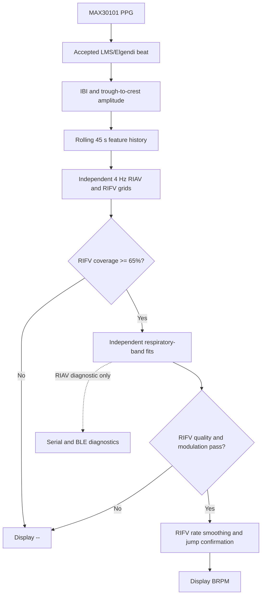

# Passive PPG-derived respiration

PDR is calculated and displayed only. It has no P1, stress, haptic, baseline,
support, or rate-match interface. Its output is read only by telemetry.

## Processing flow

The implementation follows the PDR calculation flowchart: acquire PPG, retain
accepted beats, derive beat-level features, assess rolling-window coverage,
estimate respiratory modulation, then publish only a sufficiently reliable
breaths-per-minute (BRPM) value.



## Calculation

After LMS rhythm acquisition, each accepted, directly observed PPG beat is copied
to the PDR worker: crest timestamp, local peak-to-trough height (RIAV), and
individual unsmoothed IBI (RIFV). Reconstructed acquisition intervals are excluded.
The existing RMSSD artifact filter still runs independently and is unchanged.
The passive amplitude helper follows the existing threshold regions; it neither
selects nor accepts beats. It subtracts the preceding trough from the strongest
crest and rejects missing/stale troughs and clipped input. The original crest
amplitude still drives the existing detector, with no changes to its decisions.

A bounded, nonblocking queue feeds a priority-1 task on core 0. Every two seconds,
the observer takes the most recent 45 seconds, linearly interpolates beat features
at 4 Hz, removes a Hann-weighted linear trend, and normalizes each channel by its
weighted mean. RIAV is timestamped at the crest; RIFV at the midpoint of the
interval it measures. Each has an independent interpolation mask. `Cover` reports
RIFV coverage because RIFV is the BRPM source; `CoverAV` and `CoverFV` expose the
independent per-channel coverages. Neither channel is extrapolated.

Hann-weighted sinusoidal least-squares projections form independent RIAV/RIFV
spectra. Band selection excludes non-respiratory power from the quality
denominator rather than demanding a perfect sine explain the whole signal.
Quality is the power within the winning Hann main lobe (+/-2/45 Hz, about
2.67 brpm either side) divided by total power in the permitted breathing band.
Normalized modulation is estimated from integrated band power, accounting for
scan spacing and the Hann window's 1.5-bin equivalent noise bandwidth.
Log-power parabolic interpolation refines an interior peak between scan bins.

RIAV and RIFV are fitted independently so both remain visible for diagnostics.
The final BRPM path is RIFV only: a usable RIFV candidate supplies the rate and
quality; RIAV does not gate, fuse with, override, or reject that result. Invalid
final rates are NaN internally and displayed as `--`, never zero breathing.

## Constants

| Setting | Value |
|---|---|
| Rolling analysis window | 45,000 ms |
| Initial warmup | 45,000 ms from the first usable beat |
| Resampling | 250 ms / 4 Hz, 180 points |
| Analysis cadence | 2,000 ms |
| Respiratory search | 6-30 brpm / 0.10-0.50 Hz |
| Search spacing | 0.5 brpm |
| Minimum RIFV quality | 0.30 on a 0-1 scale |
| Quality definition | Respiratory-band power concentration in the winning main lobe |
| Minimum normalized modulation SD | RIAV 0.005; RIFV 0.003 |
| Minimum RIFV interpolated coverage | 65% |
| Maximum beat/context/output gap | 2,500 ms |
| Beat buffer / input queue | 256 beats / 64 events |
| Stable-rate smoothing | 75% previous + 25% accepted RIFV candidate |
| Sudden-rate change confirmation | 2 matching candidates; jump threshold 6 brpm |
| Valid-rate hold | 10,000 ms |

The upper breathing-band bound also stays below 45% of the mean beat frequency; resampling
does not restore information lost at low heart rates. Segments longer than
1.8 times the local IBI are not interpolated. No extrapolation beyond the last
beat is used; a beat just before the window may bracket its first sample.
The search spacing is not a claim of physical measurement resolution.
Guard frequencies from 0.5 brpm to min(60 brpm, 45% of mean beat frequency) are
also examined. A stronger peak outside the allowed breathing band rejects the
channel: out-of-band leakage must not turn into a false boundary breathing rate.

The 45-second warmup clock starts once, at the first usable beat, and never
restarts until reboot. The analysis always uses ONLY the latest 45 seconds of
wall time, not an ever-growing or frozen set of samples.

An invalid input context or HIGH motion immediately invalidates PDR and pauses
beat collection. LOW and MODERATE motion remain eligible for PDR collection;
this is local to PDR and does not change other motion gates. A bad-context event
retracts only samples newer than the preceding good-context boundary, retaining
the boundary beat and older valid history. The first returning interval is skipped,
and interpolation cannot cross a pause boundary. An isolated missing-beat gap
similarly remains missing data, not invented beats.

Contact/rhythm changes, invalid timestamps, missing context, or queue/data loss
still discard suspect samples for integrity, but do not restart the clock. After
warmup has completed, insufficient new data is GAP, not a new WARMUP. Every new
estimate must still pass coverage, freshness, modulation and quality checks.
Keeping Win full does not force Cover to 65%; missing/corrupted intervals do not
count, and old samples expire from the rolling analysis.
Context is submitted every 100 ms or immediately when its flags change.
Quality is a heuristic spectral-concentration score, not a calibrated probability
or a clinically validated confidence measure.

## Serial and BLE

Both transports use the same PDR line, for example:

```text
[266s] PDR | Rate:14.2 brpm | Q:0.82 | RIAV:14.0 | RIFV:14.5 | VALID
[12s] PDR | Rate:-- | Q:-- | RIAV:-- | RIFV:-- | INVALID | Reason:WARMUP
```

The one-second telemetry reports repeat the latest two-second estimate.
Other invalid reasons include SIGNAL, MOTION, GAP, WEAK, and STALE; `HELD`
means the most recent valid RIFV result is being retained within the 10-second
hold period.
The existing BLE PDR READ characteristic and all-groups notification stream
carry this line when BLE is enabled; UUIDs and the BLE enable switch are unchanged.

### Diagnostic fields appended to the PDR line

The examples above show the summary prefix. Each report now also includes:

- `AVcand` / `FVcand`: best-fit RIAV/RIFV rates, even when rejected. These
  are diagnostic candidates, NOT accepted respiration measurements.
- `AVQ` / `FVQ`: per-channel respiratory-band concentration scores (0-1), not
  directly comparable to a whole-signal explained-variance score. `FVQ` is used
  as the final Q when RIFV publishes BRPM.
- `AVMod` / `FVMod`: estimated normalized respiratory-band RMS modulation,
  expressed as a percentage. Required minima remain 0.500% and 0.300%.
- `AVWhy` / `FVWhy`: OK, LOW_MOD (insufficient modulation), LOW_Q (score
  below 0.30 or a stronger out-of-band peak), NO_FIT, or NOT_ANALYZED. LOW_MOD takes precedence when both
  strength and periodicity fail. Zero residual energy has no candidate rate;
  tiny floating-point residuals can still produce a rejected LOW_MOD candidate.
- `Win`: one-time elapsed warmup since the first usable beat, capped permanently
  at 45 seconds until reboot. It is NOT the amount of currently usable data.
- `Cover`: RIFV interpolated coverage at the last analysis (minimum 65%).
  `CoverAV` and `CoverFV` show the individual RIAV and RIFV values.
- `BeatAge`: time since the newest retained beat, or -- if no history remains.
- `BeatGap`: latest observed beat gap over 2.5 seconds, in milliseconds (zero
  before the first gap). This historical diagnostic persists after recovery;
  while a gap is ongoing it follows beat age. It is not a reset counter.
- `Resets`: number of nonempty beat histories discarded.
- `LastReset`: last discard cause, its device-uptime timestamp in milliseconds,
  and the measured triggering gap when applicable. Gap:0ms means no timed gap
  applies. The metadata persists during warmup; repeated checks of an empty
  history do not increment it.

Reset causes distinguish CONTEXT_GAP (context updates over 2.5 s apart),
TIMESTAMP (duplicate/backward beat time), QUEUE_OVERFLOW,
DATA_LOSS, and CONTACT (contact/rhythm reset notification). SIGNAL_INPUT and
MOTION reset labels remain defined for compatibility; these conditions now pause
collection instead of discarding the whole history. They remain visible as
SIGNAL/MOTION status. Compare finger contact, motion and IMU reports.
A low-coverage GAP rejects an analysis but does not itself clear history.
BEAT_GAP and BEAT_STALE labels remain defined for compatibility, but isolated
beat gaps now update BeatGap instead of discarding history.

Final Q is -- whenever the final rate is invalid; use AVQ/FVQ for measured
scores. Per-channel diagnostics and coverage are cleared when a window is
discarded, so previous estimates cannot be mistaken for current input.
Diagnostic fitting also runs on weak nonzero modulation. Quality/modulation
measure respiratory-band power as described above. The rolling window stays
45 seconds; good samples surrounding motion/signal pauses are retained too.
Serial and BLE share these fields with no new characteristic or trigger input.

## Validation

PlatformIO native tests cover warmup, irregular timestamps, independent channels,
both band endpoints, out-of-band modulation, flat inputs, noise, motion/contact/data
gaps, rolling-window replacement, cadence, and rollover.
Gap regression tests verify that a short hole preserves history without counting
the hole as coverage, and a long hole cannot produce a valid estimate.
Persistent-window tests cover signal/motion pauses during and after warmup,
contact discard without clock restart, long corrupted periods, and clock wrap.
Known-rate tests include independently phased peak-height/IBI variation, interval
midpoint timing, harmonics, slow rate variation, and out-of-band interference.
Negative controls include independent noise seeds, competing peaks, near-band
leakage, and flat channels. Pulse-height tests verify invariance
to a constant baseline offset and rejection of missing/stale troughs.
Telemetry tests cover valid/unavailable output and P1 independence.
Firmware is built using the seeed_xiao_esp32s3 environment.

Synthetic tests do not establish respiratory accuracy on hardware. Periodic
motion or optical artifacts can still resemble breathing. The existing detector
uses processing-time timestamps; compare LoopMax and sensor readings under
Serial/BLE load and validate PDR against an independent respiration reference.
